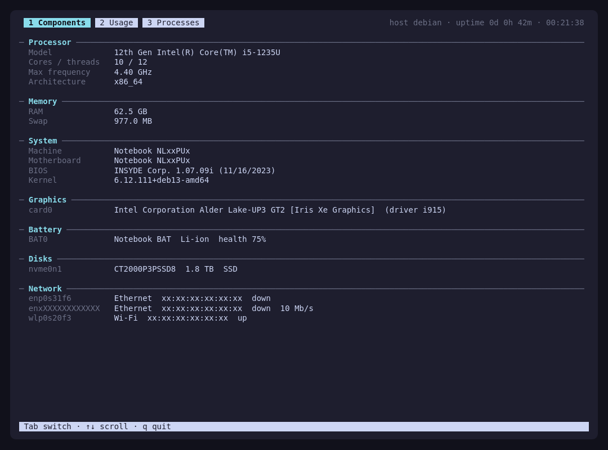
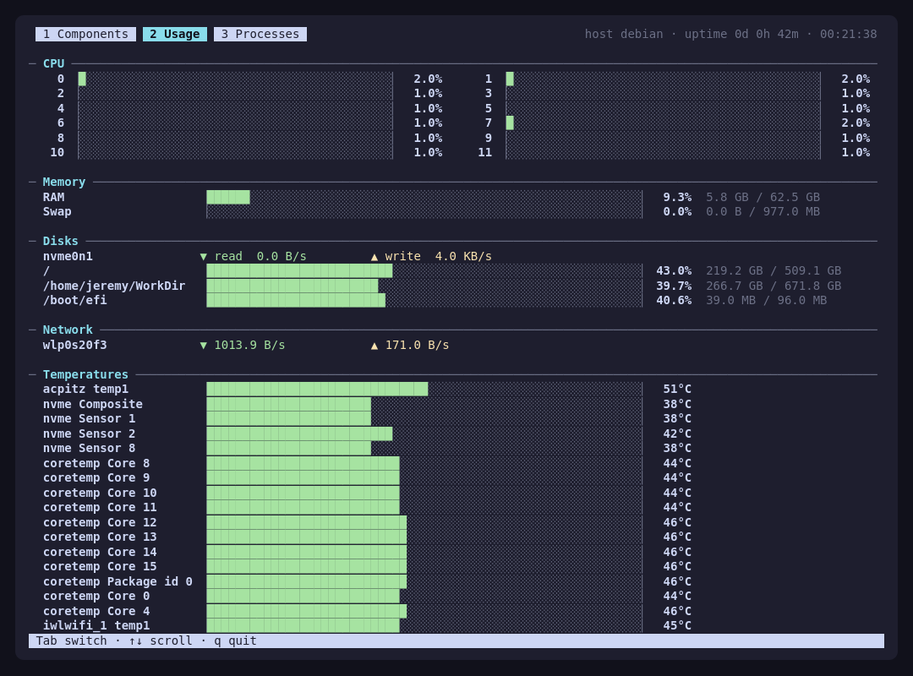
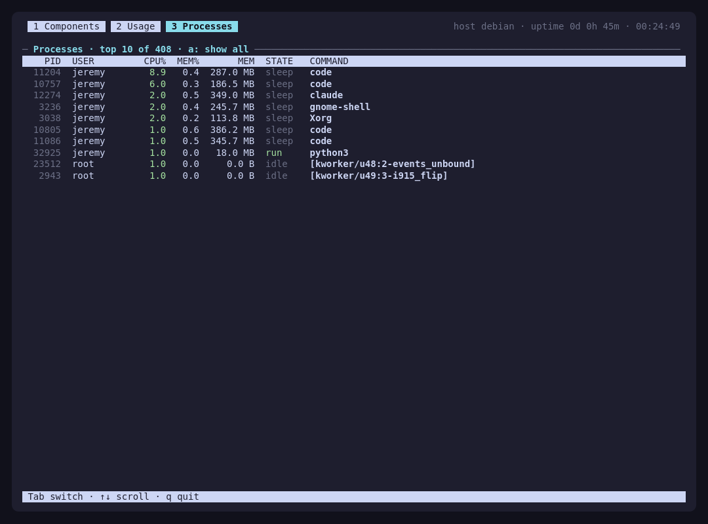

# jtop

Hardware components and live usage in your terminal, htop style.
Three tabs: **Components** (CPU, memory, motherboard, GPU, battery, disks, network), **Usage**
(per-core CPU, RAM/swap, disk and network throughput, filesystems, temperatures, battery)
and **Processes** (sorted by CPU, with memory, user and command).

Linux: Python 3 standard library, no dependencies, installs with apt. Windows 11: installs with [pipx](#install-windows-11).







## Install (Debian / Ubuntu)

```sh
sudo curl -fsSLo /usr/share/keyrings/jtop.gpg https://notdjz.github.io/jtop/jtop.gpg
echo "deb [signed-by=/usr/share/keyrings/jtop.gpg] https://notdjz.github.io/jtop ./" | sudo tee /etc/apt/sources.list.d/jtop.list
sudo apt update
sudo apt install jtop
```

Then run `jtop`. Updates come with `sudo apt upgrade`.

For fun: `jtop --fun`

## Install (Windows 11)

Download `jtop.exe` from the [latest release](https://github.com/NotDjz/jtop/releases/latest) and run it: nothing
else to install. The exe is not signed, so SmartScreen may warn the first time: More info, then Run anyway.
A new version means downloading the new exe. It has the jtop icon: right-click it to pin it to Start or the
taskbar. For fun: `jtop.exe --fun` from a terminal in its folder.

Or take `jtop-<version>-x64.msi` from the same release and double-click it: it installs for your account only (no
admin prompt) into `%LOCALAPPDATA%\Programs\jtop`, adds jtop to the Start menu, and puts the `jtop` command on your
PATH, so `jtop` and `jtop --fun` work in any new terminal. A newer MSI replaces the older one. Uninstall it from
Settings > Apps. Use the MSI or pipx below, not both: each adds its own `jtop` to the PATH and to the Start menu.

Or, with a 64-bit Python 3, git and [pipx](https://pipx.pypa.io), which also brings updates:

```powershell
pipx install git+https://github.com/NotDjz/jtop
```

Then run `jtop`. Updates come with `pipx upgrade jtop`.

To get a Start menu entry with an icon for the pipx install, which you can then pin to the taskbar:

```powershell
irm https://raw.githubusercontent.com/NotDjz/jtop/main/shortcut.ps1 | iex
```

For fun: `jtop --fun`

No temperatures, which Windows does not expose without a driver. Without administrator rights, system processes
show `?` as their user and their name instead of their command line.
